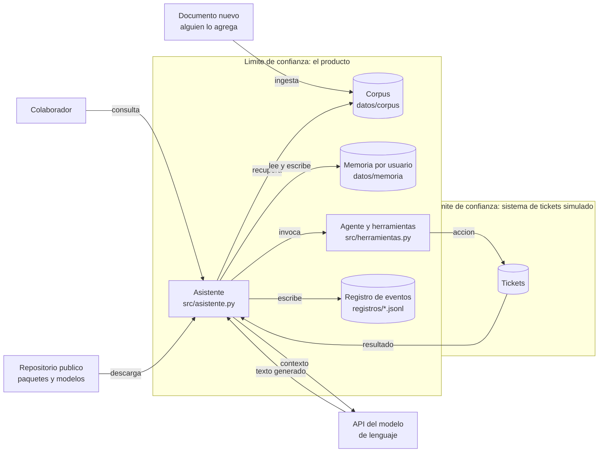

# Arquitectura

**Entregable 2** · Grupo Ciber2026 · Mesa de ayuda interna de TI

El diagrama marca los componentes, los flujos de información y los **límites de
confianza**. Un límite de confianza es el punto donde la información pasa entre
partes con distinto nivel de confianza. Se busca en cada flecha que trae
información desde fuera de lo que el producto controla, y el principio que lo
acompaña es que todo lo que cruza se trata con sospecha.

## Diagrama

## Los seis límites de confianza

Cada entrada que cruza un límite genera al menos una fila del modelo de amenazas.
Los dos primeros son los de la demostración de la sesión 1; el sexto es el de la
cadena de suministro de la sesión 2.

| # | Qué cruza | Desde dónde | Por qué es un límite | Dónde está en el código |
| --- | --- | --- | --- | --- |
| 1 | La consulta | El colaborador | Puede traer instrucciones además de una pregunta, y el modelo lee las dos cosas como texto | `Asistente.responder` |
| 2 | Un documento nuevo | La ingesta al corpus | El asistente no distingue un documento que debe leer de una orden que debe seguir | `datos/corpus/`, `corpus.cargar` |
| 3 | El contexto y la respuesta | La API del modelo de lenguaje | Un tercero procesa el contenido y devuelve texto que el producto entrega al usuario | `modelo.ModeloDeepSeek` |
| 4 | El resultado de una herramienta | El sistema de tickets | Lo que devuelve vuelve al contexto del modelo en el siguiente turno | `herramientas.invocar` |
| 5 | La memoria recuperada | La sesión anterior del mismo usuario, o de otro | Contenido escrito en un turno que no se está auditando ahora | `memoria.Memoria.recuperar` |
| 6 | Paquetes y modelos descargados | Repositorios públicos | Cargar un artefacto de origen desconocido equivale a ejecutar un programa de origen desconocido | `requirements.txt` |

## Qué registra y qué no registra

El registro es un archivo JSONL por corrida, una línea por evento. Esta tabla es
la que sostiene la columna «señal en el registro» del modelo de amenazas, y se
contrasta contra una corrida real en `registros/muestra-hito1.jsonl`.

| Evento | Campos | Qué permite reconstruir |
| --- | --- | --- |
| `consulta_recibida` | `id_consulta`, `id_sesion`, `id_usuario`, `consulta` | Quién preguntó qué y en qué sesión |
| `memoria_recuperada` | `id_usuario`, `cantidad`, `entradas` | Qué memoria entró al contexto |
| `control_evaluado` | `control`, `decision`, `motivo` | Si el control estaba activo en esa corrida |
| `documentos_recuperados` | `id`, `titulo`, `clasificacion`, `puntaje` | Qué documentos vio el modelo |
| `herramienta_invocada` | `herramienta`, `argumentos`, `permitida`, `resultado` | Qué acción se ejecutó y si fue bloqueada |
| `respuesta_entregada` | `respuesta`, `proveedor`, `modelo`, `semilla` | Qué se entregó y con qué versión del modelo |
| `memoria_escrita` | `entrada` | Qué quedó guardado para la sesión siguiente |

### Puntos ciegos conocidos

El registro no lo captura todo, y documentarlo es parte del entregable. A hoy
**no queda rastro** de:

- **Quién agregó o modificó un documento del corpus**, ni cuándo. El producto
  solo registra que lo recuperó. Es el mismo punto ciego de la demostración de la
  sesión 1 y rompe el no repudio.
- **La autenticación del usuario.** El identificador llega como parámetro y el
  producto lo acepta: no hay prueba de que quien consulta sea quien dice ser.
- **El contenido del documento en el momento de la recuperación.** Se guarda el
  identificador y el puntaje, no el texto, así que un documento alterado después
  de la corrida no se puede comparar con lo que el modelo realmente leyó.
- **La procedencia de los paquetes y modelos descargados.** No se calcula ni se
  verifica la huella de ningún artefacto.

Estos cuatro huecos son filas del modelo de amenazas, no defectos a esconder.
